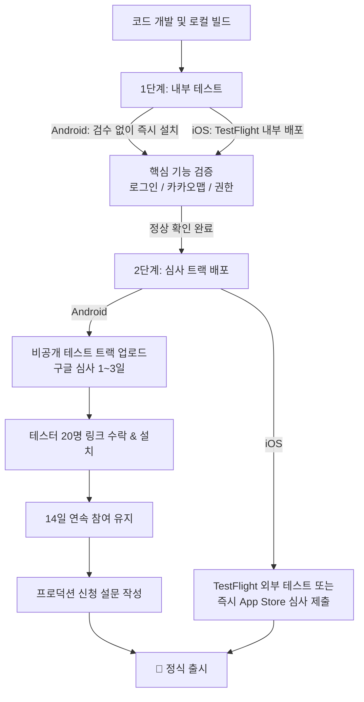

# 🧪 Android & iOS 앱 테스트 가이드

하루여행(OneDay Trip) 앱의 출시 전 테스트 트랙별 절차, 요건 및 운영 가이드입니다.

---

## 📌 플랫폼별 테스트 트랙 한눈에 보기

| 구분 | Google Play (Android) | Apple App Store (iOS) |
| :--- | :--- | :--- |
| **빠른 자가 검증** | **내부 테스트 (Internal Testing)** - 검수 없음 (즉시 배포) - 최대 100명 | **TestFlight 내부 테스트** - 애플 검수 없음 (즉시 배포) - 개발팀원 최대 100명 |
| **출시 전 필수/외부 테스트** | **비공개 테스트 (Closed Testing)** - 구글 검수 필수 (1~3일) - **개인 계정: 20명 14일 의무** | **TestFlight 외부 테스트** - 베타 심사 있음 (1일 내외) - 최대 10,000명 (기간 제한 없음) |
| **정식 출시 전 제약** | **20명 테스터가 14일간 참여 유지 필수** | **인원/기간 의무 조건 없음** (즉시 심사 제출 가능) |

---

## 📑 가이드 문서 바로가기

1. **[01. Android 테스트 절차 가이드 (내부 vs 비공개 20명 요건)](01_안드로이드_테스트_절차_가이드.md)**
   - 내부 테스트 vs 비공개 테스트의 역할 분담
   - 20명 14일 비공개 테스트 통과 전략 및 테스터 모집/관리
   - 프로덕션(정식 출시) 신청 설문 작성 요령

2. **[02. iOS TestFlight 테스트 절차 가이드](02_iOS_테스트플라이트_절차_가이드.md)**
   - 내부 테스터 vs 외부 테스터 차이점
   - Xcode 빌드 업로드(Archive) 및 배포 절차
   - 테스터 초대 및 실기기 설치 방법

3. **[03. Google Play Console vs Firebase App Distribution 비교](03_콘솔_vs_파이어베이스_테스트_비교.md)**
   - 파이어베이스 배포와 콘솔 테스트의 차이점
   - 무엇을 언제 써야 하는지 추천 전략

---

## 💡 권장 테스트 워크플로우

